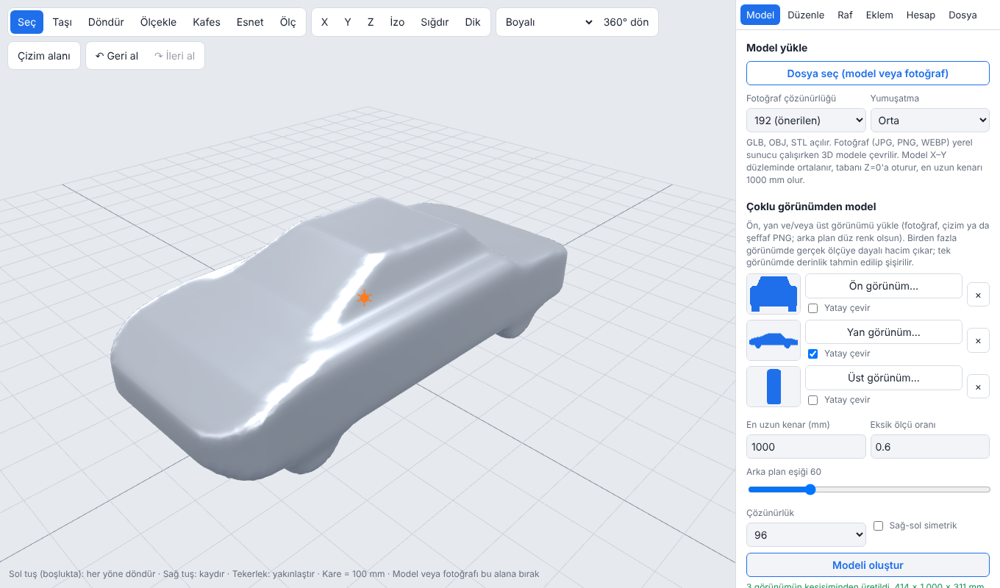

# DreamDesign

**Photo to 3D, edit, and design anything.** A free, open-source, Fusion-360-style 3D design workspace that runs in your browser: turn photos and silhouettes into 3D models, then reshape, cut, measure, rig and export them. Start with a flying car, a robot dog or a humanoid — the only limit is your imagination.

[Türkçe README](README.tr.md) · **[Try it online](https://066040.github.io/DreamDesign/)** · [Report a problem](https://github.com/066040/DreamDesign/issues)



> **Status: beta (v0.1).** It works and is tested, but it is young. The interface is currently **Turkish only** (English UI is the first roadmap item); the docs are bilingual. Your browser's "translate page" works well in the meantime.

## Simple mode for complete beginners

DreamDesign opens in **Basit** (simple) mode; the *Basit / Gelişmiş* switch at the top left toggles it (remembered; also `?mod=basit` / `?mod=gelismis`). Big buttons, no jargon: add a box, rounded box, cylinder, sphere or cone (or open a file); type its size in mm; pick a colour; move it on the bed, turn it, lay it down, copy or delete it; *make it a cup* (hollow with an open top), *drill a hole* where you click, *round the corners*; *join everything into one part*. A live print price and an order button are always at the bottom. Same geometry code as the advanced mode.

## What you can do

- **Model from several views** – give a front, side and/or top photo or drawing; DreamDesign intersects the silhouettes into a real, measured solid. One view only? It inflates the shape and you tell it how deep it should be.
- **Photo to 3D (optional backend)** – drop in a single photo and [TripoSR](https://github.com/VAST-AI-Research/TripoSR) builds a 3D model locally on your own GPU (works on 4 GB cards, or CPU).
- **Reshape like clay** – a lattice *cage* lets you pull the roof down, stretch a nose or a mug handle, with left/right symmetry. There is also local grab-and-pull, numeric move/scale, and 90° re-orientation.
- **Pull and bend a single edge or corner** – hover a sharp edge or corner, grab it and drag: only that edge moves, the faces next to it tilt and stay flat, the far side stays put. Switch to *Bend* and the edge becomes a true circular arc; the arc angle, radius and sag are shown live, or type an angle (e.g. 30°) and apply.
- **Holes and bosses** – click a face, type the diameter and depth (or through), and drill; or add a cylindrical boss. Real solid operations, so volume and mass stay correct.
- **Real boolean operations** – union, subtract and intersect between parts (via [manifold](https://github.com/elalish/manifold), loaded on first use).
- **Cut, merge, mirror, clone** – exact plane cuts with caps, welding, mirrored copies.
- **See it your way** – painted, triangle skeleton, silhouette outline, section lines, centre line; perspective or true orthographic; one-key X/Y/Z views; grid and live dimensions.
- **Sketch → solid** – 2D sketch area with lines, rectangles, circles and typed dimensions; extrude or revolve into a part, or trace a photo outline at real size.
- **Assemble** – a shelf of parts you drag onto the model (they snap to the surface); revolute and sliding joints with poses.
- **Engineering numbers** – volume, mass per material, centre of gravity, hover power / disk loading / endurance / stall speed for aircraft concepts.
- **Measure** – click two points for a distance, or three points for an angle; measurements stay attached to their part. Hovering an edge shows its length and the angle between its faces.
- **Prepare for printing (Baskı tab)** – pick your printer (P1S, A1 mini, Ender-3, Prusa MK4… or custom); see whether it fits and shrink to fit in one click. Faces that need support are shown in red, with support grams and bed contact area. *Lay with least support* turns the part to the orientation that needs the least support. Live print price and one-click hand-off to the quote page for ordering.
- **Rounded box** – a box with a real corner radius in mm, handy for device enclosures.
- **Enclosure from a KiCad board** – pick or drop a `.kicad_pcb` file: DreamDesign reads the board outline, thickness, mounting holes and component heights, then builds a tray that fits it with screw standoffs, wall openings for edge USB / buttons / connectors, and a press-fit lid laid out ready to print. The board is shown inside as a preview that stays out of exports.
- **Step list (Yapılanlar)** – every part remembers how it was made: *Box 25 × 25 × 10 mm → Hole Ø3 → Chamfer 1 mm*. Change any step's size later, or remove a step, and the part is rebuilt from the start with the remaining steps applied again. Saved with the project and covered by undo.
- **Undo/redo everything** – `Ctrl+Z` / `Ctrl+Y` cover edits, sketches, joints and measurements.
- **Import / export** – GLB, OBJ, STL in; STL, OBJ, GLB and a project file out.
- **Hand gestures (experimental)** – orbit, zoom and pan with your webcam via MediaPipe (local server only).

## Instant print quote page

**[docs/bastir.html](https://066040.github.io/DreamDesign/bastir.html)** (Turkish UI) is a deliberately simple page for people with no 3D experience: upload an STL/OBJ, resize it with a slider or typed millimetres, pick material (PLA, PETG, ASA), colour, strength and quantity, and the price updates live.

- Volume and surface area give grams, print time and price; edit the price table in `QUOTE_CFG` (`app/src/quote/price.js`).
- Models too big for the printer (default Bambu Lab P1S, 256 mm) are scaled to fit; open meshes and files saved in cm/inch are flagged.
- A one-click "too expensive?" suggestion (lighter infill or 80% size).
- Support material for overhangs is priced in; "lay with less support" turns the model to the cheapest orientation.
- DreamDesign's *Baskı → open in quote page* hands the model, material and strength over to this page.
- Ordering opens WhatsApp to `QUOTE_CFG.whatsapp` with a summary and downloads the scaled STL. Embedded in an `<iframe>`, it posts the order and STL to the parent page via `postMessage({type:'3ddream-order', ...})`.

Build: `node app/src/quote/build.js` → `docs/bastir.html`.

## Quick start

### 1. Just the design tools (no install)

Open **<https://066040.github.io/DreamDesign/>**, or download this repository and open `docs/index.html` in a browser. Everything except single-photo-to-3D and webcam gestures works this way.

### 2. With photo-to-3D (local server)

Needs Python 3.11 and (recommended) an NVIDIA GPU; CPU works but is slow.

- **Windows:** double-click `scripts/install.bat`, then `scripts/run.bat`.
- **Linux/macOS:** `scripts/install.sh`, then `scripts/run.sh`.

The browser opens at <http://localhost:8000>. The first run downloads the model weights (~1.7 GB). Drop a photo on the viewport.

> The installer scripts follow the manual steps we used to get TripoSR running on Windows with a 4 GB GPU. Linux/macOS scripts are less tested — please open an issue if something fails.

**Using the online page with your local server:** start the server (`run.bat`), open the hosted page, and enter `http://localhost:8000` in *Server address* (Model tab), then press *Connect*. Chrome/Edge/Firefox allow this; Safari blocks it, so use <http://localhost:8000> directly there. If you host your own copy of the page, add its origin with `DD_ORIGINS=https://you.github.io`.

Server settings (environment variables): `TSR_DEVICE=cpu`, `TSR_RES` (mesh resolution, default 192), `TSR_QCHUNK`, `TSR_SMOOTH`. If the GPU runs out of memory the server automatically retries at lower resolution.

## Keyboard shortcuts

| Key | Action | Key | Action |
|---|---|---|---|
| `1` `2` `3` / `0` | X / Y / Z view / isometric | `Q` `G` `R` `S` | select / move / rotate / scale |
| `F` | fit to view | `E` | grab-and-pull |
| `P` | perspective ⇄ orthographic | `K` | lattice cage |
| `W` | triangle skeleton on/off | `M` | measure |
| `B` | pull / bend an edge or corner | `H` | hole / boss |
| `D` | sketch area | `Ctrl+Z` / `Ctrl+Y` | undo / redo |

## Honest limits

- A **single photo cannot show the back of an object.** TripoSR guesses it; the result is a plausible model, not a measurement. Use two or three views for measured results.
- Boolean operations and holes need closed (watertight) surfaces; AI-generated meshes may need *Surface clean-up* first. Cut caps can be imperfect on very concave cross-sections. Fillets are only available through the rounded box, not on arbitrary edges yet.
- The step list is a recipe on a mesh, not a full parametric CAD kernel. Recorded steps: ready-made shapes, holes and bosses, round/chamfer, make cup, resizing, 90° turns. Free-form edits (cage, grab, edge pull, cuts, booleans with another part, print auto-orientation) lock the steps before them: they stay visible but can no longer be changed. Holes keep their offset from the part's centre, not from an edge.
- The KiCad enclosure reads the board file only, not its 3D models: component heights come from the model file name (`…-H1.8…`) or a table of common packages and are otherwise guessed at 2 mm, so check the suggested clearances. Openings are rectangular and offered only for parts within 1 mm of a straight board edge; displays, batteries and other off-board parts are not known to it. Side buttons end up recessed inside the wall.
- The sketcher has no constraint solver and no holes.
- Mass and volume assume closed surfaces, so AI-generated meshes give approximate values.
- Hand gestures have only been exercised with simulated input, not on many real webcams.
- Tested with the author's setup (Windows, 4 GB NVIDIA GPU). Other setups: please report.

## Project layout

```
app/src/     web app source (plain JS, no framework) – build.js bundles it
docs/        built single-file app (served by GitHub Pages) + screenshots
server/      optional photo-to-3D backend (FastAPI + TripoSR) and mesh clean-up
scripts/     install / run scripts
tests/       unit + jsdom UI tests, server mock test
```

## Development

```bash
node app/src/build.js          # writes docs/index.html
cd tests && npm install && npm test
python tests/test_meshfix.py   # needs: numpy trimesh scikit-image
```

Edit files in `app/src/`, rebuild, and commit the regenerated `docs/index.html` (CI checks it is up to date). See [CONTRIBUTING.md](CONTRIBUTING.md).

## Roadmap

1. English interface (i18n) and more languages
2. Template fitting – start from a car / aircraft / humanoid skeleton and fit it to your silhouettes
3. Pluggable, stronger image-to-3D backends (local or cloud)
4. Fillets / chamfers on any edge, sketch constraints, holes inside sketches
5. Mobile / touch polish, example projects

Ideas and pull requests are welcome.

## Credits

[three.js](https://threejs.org) (MIT) · [manifold](https://github.com/elalish/manifold) (Apache-2.0) · [TripoSR](https://github.com/VAST-AI-Research/TripoSR) (MIT) · [MediaPipe](https://developers.google.com/mediapipe) (Apache-2.0) · [rembg](https://github.com/danielgatis/rembg) (MIT) · scikit-image, trimesh, FastAPI.

## License

[MIT](LICENSE). Third-party models and weights keep their own licenses — check them before commercial use.
