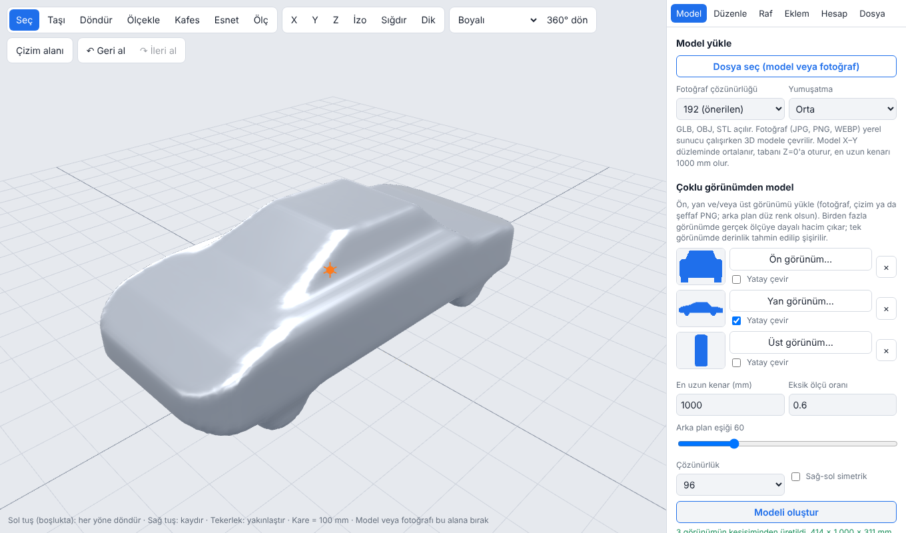

# DreamDesign

**Fotoğraftan 3D, düzenle, her şeyi tasarla.** Tarayıcıda çalışan, ücretsiz ve açık kaynaklı, Fusion 360 tarzı bir 3D tasarım ortamı: fotoğraf ve siluetlerden 3D model üret, sonra şekillendir, kes, ölç, eklem ekle ve dışa aktar. Uçan arabadan robot köpeğe, insansıya kadar — tek sınır hayal gücün.

[English README](README.md) · **[Online dene](https://066040.github.io/DreamDesign/)** · [Sorun bildir](https://github.com/066040/DreamDesign/issues)



> **Durum: beta (v0.1).** Çalışıyor ve test edildi ama genç bir proje. Arayüz şimdilik **yalnızca Türkçe**; İngilizce arayüz yol haritasının ilk maddesi.

## Neler yapabilirsin

- **Çoklu görünümden model** – ön, yan ve/veya üst fotoğraf ya da çizim ver; siluetler kesiştirilip gerçek ölçülü bir katı çıkar. Tek görünüm varsa şekil şişirilir, derinliği sen belirlersin.
- **Fotoğraftan 3D (isteğe bağlı sunucu)** – tek fotoğraf at, [TripoSR](https://github.com/VAST-AI-Research/TripoSR) kendi ekran kartında modeli üretir (4 GB kartta da çalışır, ekran kartı yoksa işlemci ile).
- **Kil gibi şekillendir** – nokta *kafesi* ile tavanı alçalt, burnu ya da kulpu uzat; sol-sağ simetri var. Ayrıca tutup çekme, sayısal taşı/ölçekle, 90° yön çevirme.
- **Kes, birleştir, ayna kopya, kopyala** – kapaklı tam düzlem kesimi, birleştirme.
- **İstediğin gibi gör** – boyalı, üçgen iskelet, ana hat, kesit çizgileri, orta hat; perspektif ya da gerçek dik görünüm; tek tuşla X/Y/Z; ızgara ve canlı ölçüler.
- **Çizim → katı** – çizgi, dikdörtgen, daire ve yazılan ölçülerle 2B çizim; ekstrüde ya da döndürerek parça yap, fotoğraf ana hattını gerçek boyutta çıkar.
- **Montaj** – parçaları modele sürükleyip bırak (yüzeye oturur); dönel ve kayar eklemler, pozlar.
- **Mühendislik hesapları** – hacim, malzemeye göre kütle, ağırlık merkezi; hava aracı için asılı kalma gücü, kanat yükü, süre, tutunma hızı.
- **Ölçüm** – modelde iki noktaya tıkla; ölçüler parçasına bağlı kalır.
- **Her şeyi geri al** – `Ctrl+Z` / `Ctrl+Y` düzenleme, çizim, eklem ve ölçümleri kapsar.
- **İçe/dışa aktar** – GLB, OBJ, STL açılır; STL, OBJ, GLB ve proje dosyası kaydedilir.
- **El hareketi (deneysel)** – kamerayla döndür, yakınlaştır, kaydır (yalnız yerel sunucuda).

## Hızlı başlangıç

### 1. Sadece tasarım araçları (kurulum yok)

**<https://066040.github.io/DreamDesign/>** adresini aç ya da bu depoyu indirip `docs/index.html` dosyasını tarayıcıda aç. Tek fotoğraftan 3D ve kamera hareketi dışında her şey böyle çalışır.

### 2. Fotoğraftan 3D ile (yerel sunucu)

Python 3.11 gerekir; NVIDIA ekran kartı önerilir (yoksa yavaş ama işlemci ile çalışır).

- **Windows:** `scripts/install.bat` dosyasına çift tıkla, sonra `scripts/run.bat`.
- **Linux/macOS:** `scripts/install.sh`, sonra `scripts/run.sh`.

Tarayıcı <http://localhost:8000> adresinde açılır. İlk çalıştırmada model ağırlıkları (~1,7 GB) iner. Fotoğrafı görüntü alanına sürükle.

> Kurulum betikleri, 4 GB ekran kartlı Windows'ta TripoSR'ı çalıştırırken uyguladığımız adımlara dayanır. Linux/macOS betikleri daha az test edildi; sorun olursa issue aç.

Sunucu ayarları (ortam değişkenleri): `TSR_DEVICE=cpu`, `TSR_RES` (ağ çözünürlüğü, varsayılan 192), `TSR_QCHUNK`, `TSR_SMOOTH`. Ekran kartı belleği yetmezse sunucu otomatik olarak daha düşük çözünürlükle yeniden dener.

## Kısayollar

| Tuş | İş | Tuş | İş |
|---|---|---|---|
| `1` `2` `3` / `0` | X / Y / Z görünümü / izometrik | `Q` `G` `R` `S` | seç / taşı / döndür / ölçekle |
| `F` | görünüme sığdır | `E` | tutup çek |
| `P` | perspektif ⇄ dik | `K` | kafes |
| `W` | üçgen iskelet aç/kapat | `M` | ölç |
| `D` | çizim alanı | `Ctrl+Z` / `Ctrl+Y` | geri al / ileri al |

## Dürüst sınırlar

- **Tek fotoğraf nesnenin arkasını göstermez.** TripoSR arka yüzü tahmin eder; sonuç makul bir modeldir, ölçüm değildir. Ölçülü sonuç için iki ya da üç görünüm kullan.
- Henüz gerçek boolean işlemi yok (çakışan parçaların kütlesi iki kez sayılır); çok girintili kesitlerde kesim kapağı kusurlu olabilir.
- Çizim alanında kısıt çözücü ve delik yok.
- Hacim ve kütle kapalı yüzey varsayar; yapay zeka ağlarında yaklaşık çıkar.
- El hareketi çok sayıda gerçek kamerada denenmedi.
- Yazarın düzeninde (Windows, 4 GB NVIDIA) test edildi. Diğer düzenler için geri bildirim bekliyoruz.

## Geliştirme

```bash
node app/src/build.js          # docs/index.html üretir
cd tests && npm install && npm test
python tests/test_meshfix.py   # gerekir: numpy trimesh scikit-image
```

`app/src/` içini düzenle, yeniden derle ve üretilen `docs/index.html`'i commit'le (CI güncel olup olmadığını denetler). Ayrıntı: [CONTRIBUTING.md](CONTRIBUTING.md).

## Yol haritası

1. İngilizce arayüz (i18n) ve daha çok dil
2. Şablon uydurma – araba / uçak / insansı iskeletinden başlayıp siluetlere oturtma
3. Takılabilir, daha güçlü görüntüden-3D arka uçları (yerel ya da bulut)
4. Gerçek boolean işlemleri, çizim kısıtları, delikler
5. Mobil / dokunmatik iyileştirmeler, örnek projeler

## Lisans

[MIT](LICENSE). Üçüncü taraf modellerin ve ağırlıkların kendi lisansları geçerlidir; ticari kullanımdan önce kontrol et.
