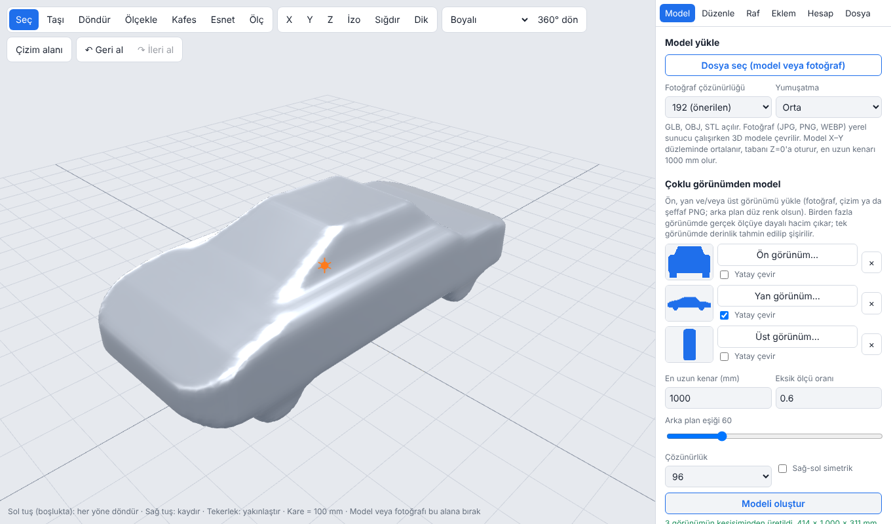

# DreamDesign

**Fotoğraftan 3D, düzenle, her şeyi tasarla.** Tarayıcıda çalışan, ücretsiz ve açık kaynaklı, Fusion 360 tarzı bir 3D tasarım ortamı: fotoğraf ve siluetlerden 3D model üret, sonra şekillendir, kes, ölç, eklem ekle ve dışa aktar. Uçan arabadan robot köpeğe, insansıya kadar — tek sınır hayal gücün.

[English README](README.md) · **[Online dene](https://066040.github.io/DreamDesign/)** · [Sorun bildir](https://github.com/066040/DreamDesign/issues)



> **Durum: beta (v0.1).** Çalışıyor ve test edildi ama genç bir proje. Arayüz şimdilik **yalnızca Türkçe**; İngilizce arayüz yol haritasının ilk maddesi.

## Basit mod: hiç bilmeyen biri için

DreamDesign ilk açılışta **Basit** modda açılır (sol üstte *Basit / Gelişmiş* anahtarı; seçim hatırlanır, `?mod=basit` ya da `?mod=gelismis` ile de seçilir). Teknik kelime yok, büyük düğmeler var:

- **Şekil ekle:** kutu, yuvarlak kutu, silindir, küre, koni ya da dosyadan aç.
- **Ölçüsünü yaz** (mm): genişlik, derinlik, yükseklik; istersen hepsi aynı oranda değişsin.
- **Renk seç**, **yerini değiştir** (yalnız tabla üstünde), **döndür**, **yan yatır**, **kopyala**, **sil**.
- **Kaba çevir:** içini oyup üstü açık kap yapar (kalemlik, saksı). **Delik aç:** yere tıkla, çapı yaz. **Köşeleri yuvarla.**
- **Hepsini tek parça yap:** üst üste konan şekilleri birleştirir.
- Altta her zaman **STL olarak indir** düğmesi durur; fiyat ve sipariş DreamDesign'ın içinde yoktur.

Hesaplar gelişmiş modla aynı koddan gelir; Gelişmiş'e geçince her şey olduğu yerde durur.

## Neler yapabilirsin

- **Çoklu görünümden model** – ön, yan ve/veya üst fotoğraf ya da çizim ver; siluetler kesiştirilip gerçek ölçülü bir katı çıkar. Tek görünüm varsa şekil şişirilir, derinliği sen belirlersin.
- **Fotoğraftan 3D (isteğe bağlı sunucu)** – tek fotoğraf at, [TripoSR](https://github.com/VAST-AI-Research/TripoSR) kendi ekran kartında modeli üretir (4 GB kartta da çalışır, ekran kartı yoksa işlemci ile).
- **Kil gibi şekillendir** – nokta *kafesi* ile tavanı alçalt, burnu ya da kulpu uzat; sol-sağ simetri var. Ayrıca tutup çekme, sayısal taşı/ölçekle, 90° yön çevirme.
- **Tek bir kenarı ya da köşeyi çek ve bük** – keskin bir kenarın ya da köşenin üstüne gel, tut ve sürükle: yalnız o kenar gelir, bitişik yüzler düz kalarak eğilir, karşı taraf yerinde kalır. *Bük*'e geçince kenar gerçek bir çember yayı olur; yay açısı, yarıçap ve sehim canlı görünür, ya da açıyı yazıp (ör. 30°) uygularsın.
- **Delik ve çıkıntı** – yüzeye tıkla, çapı ve derinliği (ya da boydan boya) yaz, del; ya da silindirik çıkıntı ekle. Gerçek katı işlemi: hacim ve kütle doğru kalır.
- **Gerçek boolean işlemleri** – parçalar arasında birleştir, çıkar, kesişim ([manifold](https://github.com/elalish/manifold), ilk kullanımda yüklenir).
- **Kes, birleştir, ayna kopya, kopyala** – kapaklı tam düzlem kesimi, birleştirme.
- **İstediğin gibi gör** – boyalı, üçgen iskelet, ana hat, kesit çizgileri, orta hat; perspektif ya da gerçek dik görünüm; tek tuşla X/Y/Z; ızgara ve canlı ölçüler.
- **Çizim → katı** – çizgi, dikdörtgen, daire ve yazılan ölçülerle 2B çizim; ekstrüde ya da döndürerek parça yap, fotoğraf ana hattını gerçek boyutta çıkar.
- **Geçme yuvası (takma çıkarma)** – kapak, pim, geçme parça: girecek parçayı gövdenin içine yerleştir, gövdede ondan her yönde 0,1–0,5 mm büyük bir yuva açılır (Sıkı / Normal / Bol / Serbest). Delik aracında da pim ya da vida için geçme payı seçilebilir.
- **Kenarları yuvarla / pah kır** – dış kenarlar, iç köşeler ya da hepsi; her şekilde çalışır. İnce duvarı silecek ya da dar boşluğu dolduracak bir yarıçapta işlem uygulanmaz ve nedeni yazılır. Hesap arka planda yürür, sayfa donmaz; uzun sürerse *Durdur*.
- **Montaj** – parçaları modele sürükleyip bırak (yüzeye oturur); dönel ve kayar eklemler, pozlar.
- **Mühendislik hesapları** – hacim, malzemeye göre kütle, ağırlık merkezi; hava aracı için asılı kalma gücü, kanat yükü, süre, tutunma hızı.
- **Ölçüm** – uzaklık için iki, açı için üç noktaya tıkla; ölçüler parçasına bağlı kalır. Bir kenarın üstüne gelince boyu ve yüzleri arasındaki açı görünür.
- **Düzenli gelişmiş mod** – üst barda dört temel araç (Seç, Taşı, Döndür, Ölçekle), bir seçim filtresi (parça / kenar ve köşe / yalnız kenar / yalnız köşe) ve diğer her şey için menüler (*Biçim ver*, *Ekle / çıkar*, *Ölç*, *Görünüm*) bulunur; bir araç seçilince yalnız onun paneli açılır. Kamera yan yatmaz: sol tuş döndürür, tekerlek imlecin olduğu yere yakınlaşır, sağ ya da orta tuş kaydırır. Taşıma ve döndürme tutamaçları tek eksende / düzlemde, 1 mm / 5° adımlarla çalışır (Alt: adımsız), sürüklerken ne kadar gittiğini yazar; ok tuşları seçili parçayı 1 mm (Shift: 10 mm) oynatır. *Parça* sekmesinde parça listesi, ölçüler, konum ve yapılanlar listesi bir aradadır.
- **Yuvarlak kutu** – köşe yarıçapı gerçek mm olan kutu; cihaz kasaları için.
- **KiCad kartından kutu** – `.kicad_pcb` dosyasını seç ya da bırak: kartın çevresi, kalınlığı, vida delikleri ve parça yükseklikleri okunur; karta oturan gövde, vida ayakları, kenardaki USB / düğme / bağlantı için duvar açıklıkları ve baskıya hazır geçmeli kapak çıkarılır. Kart, içinde önizleme olarak görünür ve dışa aktarmaya girmez.
- **Yapılanlar listesi** – her parça nasıl yapıldığını hatırlar: *Kutu 25 × 25 × 10 mm → Delik Ø3 → Pah 1 mm*. Sonradan herhangi bir adımın ölçüsünü değiştir ya da adımı sil; parça baştan kurulur, kalan adımlar kendiliğinden yeniden uygulanır. Projeyle birlikte kaydedilir, geri al kapsar.
- **Her şeyi geri al** – `Ctrl+Z` / `Ctrl+Y` düzenleme, çizim, eklem ve ölçümleri kapsar.
- **İçe/dışa aktar** – GLB, OBJ, STL açılır; STL, OBJ, GLB ve proje dosyası kaydedilir.
- **El hareketi (deneysel)** – kamerayla döndür, yakınlaştır, kaydır (yalnız yerel sunucuda).

## Fiyat al sayfası (3D baskı siparişi)

**[docs/bastir.html](https://066040.github.io/DreamDesign/bastir.html)**: bilgisayardan anlamayan birinin bile kullanabileceği sade bir sayfa. Modelini (STL/OBJ) yükle, boyutunu kaydırıcıyla ya da mm yazarak ayarla, malzeme (PLA, PETG, ASA), renk, sağlamlık ve adet seç; fiyat anında değişir.

- Hacim ve yüzey alanından gram, baskı süresi ve TL hesaplanır. Fiyat tablosu `app/src/quote/price.js` içindeki `QUOTE_CFG`'de, kendi maliyetine göre düzenle.
- Yazıcıya (varsayılan Bambu Lab P1S, 256 mm) sığmayan model otomatik küçültülür; açık yüzey ve cm/inç ile kaydedilmiş dosya uyarısı var.
- "Pahalı mı geldi?" önerisi: tek tıkla daha hafif doluluk ya da %80 boyut.
- Havada kalan yerler için destek gramı fiyata eklenir; "Daha az destekle yatır" ile modeli en ucuz yöne çevirir.
- Fiyat sayfası DreamDesign'dan bağımsızdır: tasarım aracında fiyat, sipariş ve baskı hazırlığı yoktur; model STL olarak indirilip bu sayfaya yüklenir.
- Sipariş: `QUOTE_CFG.whatsapp` numarasına özetle WhatsApp mesajı açılır, ölçeklenmiş STL indirilir. Sayfa bir siteye `<iframe>` ile gömülürse sipariş ve STL `postMessage({type:'3ddream-order', ...})` ile üst sayfaya gider.

Derleme: `node app/src/quote/build.js` → `docs/bastir.html`.

## 3D Dream mağaza sayfası

**[docs/magaza/](https://066040.github.io/DreamDesign/magaza/)**: 3D baskı işinin vitrini. Ana sayfa, nasıl çalışır, dosyası olmayanlar için parça tasarımı (eski araba parçaları), malzemeler, kendi tasarımlar (yakında) ve DreamDesign'a geçiş. "Fiyat al" düğmeleri `bastir.html`'e gider.

- WhatsApp düğmeleri sayfanın sonundaki `SITE.whatsapp` numarasını kullanır; boşken "yakında açılıyor" der. `QUOTE_CFG.whatsapp` ile aynı numarayı yaz.
- **Açılış anahtarı:** `SITE.ordersOpen` (bu sayfa) ve `QUOTE_CFG.ordersOpen` (fiyat sayfası) `false` iken fiyat görünür, sipariş alınmaz, üstte "çok yakında" şeridi çıkar. Açılışta ikisini `true` yap, iki sayfadaki `noindex` satırını sil.
- Derleme gerekmez, tek dosya. Kendi domainine taşırken `docs` klasörü Vercel/Netlify'da olduğu gibi yayınlanabilir.

## Hızlı başlangıç

### 1. Sadece tasarım araçları (kurulum yok)

**<https://066040.github.io/DreamDesign/>** adresini aç ya da bu depoyu indirip `docs/index.html` dosyasını tarayıcıda aç. Tek fotoğraftan 3D ve kamera hareketi dışında her şey böyle çalışır.

### 2. Fotoğraftan 3D ile (yerel sunucu)

Python 3.11 gerekir; NVIDIA ekran kartı önerilir (yoksa yavaş ama işlemci ile çalışır).

- **Windows:** `scripts/install.bat` dosyasına çift tıkla, sonra `scripts/run.bat`.
- **Linux/macOS:** `scripts/install.sh`, sonra `scripts/run.sh`.

Tarayıcı <http://localhost:8000> adresinde açılır. İlk çalıştırmada model ağırlıkları (~1,7 GB) iner. Fotoğrafı görüntü alanına sürükle.

> Kurulum betikleri, 4 GB ekran kartlı Windows'ta TripoSR'ı çalıştırırken uyguladığımız adımlara dayanır. Linux/macOS betikleri daha az test edildi; sorun olursa issue aç.

**Çevrimiçi sayfayı yerel sunucunla kullanmak:** sunucuyu başlat (`run.bat`), çevrimiçi sayfayı aç, Model sekmesindeki *Sunucu adresi* kutusuna `http://localhost:8000` yaz ve *Bağlan*'a bas. Chrome/Edge/Firefox buna izin verir; Safari engeller, orada doğrudan <http://localhost:8000> adresini kullan. Sayfayı kendi hesabında yayınlarsan `DD_ORIGINS=https://kullanici.github.io` ile adresini sunucuya tanıt.

Sunucu ayarları (ortam değişkenleri): `TSR_DEVICE=cpu`, `TSR_RES` (ağ çözünürlüğü, varsayılan 192), `TSR_QCHUNK`, `TSR_SMOOTH`. Ekran kartı belleği yetmezse sunucu otomatik olarak daha düşük çözünürlükle yeniden dener.

## Kısayollar

| Tuş | İş | Tuş | İş |
|---|---|---|---|
| `1` `2` `3` / `0` | X / Y / Z görünümü / izometrik | `Q` `G` `R` `S` | seç / taşı / döndür / ölçekle |
| `F` | görünüme sığdır | `E` | tutup çek |
| `P` | perspektif ⇄ dik | `K` | kafes |
| `W` | üçgen iskelet aç/kapat | `M` | ölç |
| `B` | kenar / köşe çek, bük | `H` | delik / çıkıntı |
| `D` | çizim alanı | `Ctrl+Z` / `Ctrl+Y` | geri al / ileri al |

## Dürüst sınırlar

- **Tek fotoğraf nesnenin arkasını göstermez.** TripoSR arka yüzü tahmin eder; sonuç makul bir modeldir, ölçüm değildir. Ölçülü sonuç için iki ya da üç görünüm kullan.
- Boolean işlemleri ve delik kapalı (su geçirmez) yüzey ister; yapay zeka ağlarında önce *Yüzey temizliği* gerekebilir. Çok girintili kesitlerde kesim kapağı kusurlu olabilir. Kenar yuvarlatma tek tek kenar seçmez; seçili parçanın tüm dış (ya da iç) kenarlarına uygulanır.
- Yapılanlar listesi ağ üstünde bir tariftir, tam bir parametrik CAD çekirdeği değildir. Kaydedilen adımlar: hazır şekiller, delik ve çıkıntı, yuvarlatma/pah, kaba çevirme, boyut değişikliği, 90° çevirme. Serbest biçim değişiklikleri (kafes, esnet, kenar çekme, kesme, başka parçayla birleştirme, baskı için otomatik yatırma) kendilerinden önceki adımları kilitler: listede görünür ama artık değiştirilemez. Delikler parçanın kenarına değil merkezine göre yerini korur.
- KiCad kutusu yalnız kart dosyasını okur, 3B modelleri değil: parça yüksekliği model dosyasının adından (`…-H1.8…`) ya da yaygın kılıf tablosundan alınır, bulunamazsa 2 mm sayılır; önerilen boşlukları kontrol et. Açıklıklar dikdörtgendir ve yalnız düz kart kenarına 1 mm'den yakın parçalar için önerilir; ekran, pil gibi kart dışı parçalar bilinmez. Yandan basılan düğmeler duvarın içinde kalır.
- Çizim alanında kısıt çözücü ve delik yok.
- Hacim ve kütle kapalı yüzey varsayar; yapay zeka ağlarında yaklaşık çıkar.
- El hareketi çok sayıda gerçek kamerada denenmedi.
- Yazarın düzeninde (Windows, 4 GB NVIDIA) test edildi. Diğer düzenler için geri bildirim bekliyoruz.

## Geliştirme

```bash
node app/src/build.js          # docs/index.html üretir
cd tests && npm install && npm test
python tests/test_meshfix.py   # gerekir: numpy trimesh scikit-image
```

`app/src/` içini düzenle, yeniden derle ve üretilen `docs/index.html`'i commit'le (CI güncel olup olmadığını denetler). Ayrıntı: [CONTRIBUTING.md](CONTRIBUTING.md).

## Yol haritası

1. İngilizce arayüz (i18n) ve daha çok dil
2. Şablon uydurma – araba / uçak / insansı iskeletinden başlayıp siluetlere oturtma
3. Takılabilir, daha güçlü görüntüden-3D arka uçları (yerel ya da bulut)
4. Tek bir kenarı seçerek yuvarlatma / pah, çizim kısıtları, çizimde delikler
5. Mobil / dokunmatik iyileştirmeler, örnek projeler

## Lisans

[MIT](LICENSE). Üçüncü taraf modellerin ve ağırlıkların kendi lisansları geçerlidir; ticari kullanımdan önce kontrol et.
